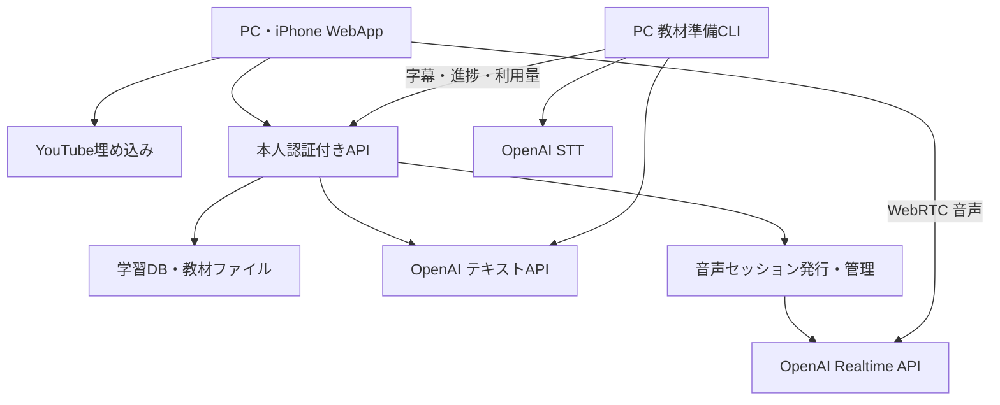

# re:Invent English Lab — WebApp設計案 v0.3

作成日：2026-11-17（日本時間）  
更新日：2026-11-17（日本時間）  
状態：音声から字幕を事前生成する方式と、モダンなWeb体験の必須条件を反映。アプリの実装・デプロイ・API疎通は未実施。

v0.3の変更：GoogleChrome/modern-web-guidanceを参照し、モバイル操作・読み込み性能・画面遷移・アクセシビリティ・互換性を必須条件に追加。実装時のガイド参照と実端末での検証を完成条件へ追加。

v0.2の変更：利用可能な教材音声を事前にSTT・時刻合わせ・日本語翻訳し、字幕データを保存して視聴時に同期表示する方式を標準にした。音声取得、バッチ処理、費用、データ保持、受け入れ条件を更新。

## 1. 目的と確認済みの前提

re:Inventで「技術の話を聞いて理解する」「自分から質問する」「聞き返して会話を続ける」を実践できるようにする。文法の正確さだけでなく、知りたい情報を英語で得られたかを中心に振り返る。

| 項目 | 決定 |
| --- | --- |
| 利用者 | Kazukiさん本人のみ |
| 提供形態 | URLから使う、本人のみアクセスできるWebApp |
| 対応端末 | PC・iPhone |
| 対話方式 | 自然な音声会話を優先。割り込み・聞き返しに対応 |
| 教材分野 | AI・SRE・データ基盤 |
| 動画字幕 | 教材音声を事前にSTT・時刻合わせ・翻訳し、保存済み字幕を再生位置と同期表示 |
| API予算 | 月3,000円程度。ホスティング費用は別に記録 |
| AI接続 | 初版はOpenAI API。ChatGPT利用枠は対応条件が満たせた機能から追加 |
| UI言語 | 操作・説明・講評は日本語。練習相手は原則英語 |
| Web体験 | GoogleChrome/modern-web-guidanceを参照し、モバイル操作・応答性・性能・アクセシビリティ・ブラウザ互換性を必須条件とする |
| 仮名称 | re:Invent English Lab。名称はいつでも変更可能 |

利用枠の追加を待たずに練習を始められるようにする。初版で「OpenAI API」と「ChatGPT利用枠」の両方が同じ機能で動くことは完成条件にしない。これは提供方式の質問で確認した方針。

未回答事項には次を仮置きする。いずれも設定変更可能で、設計を止める要因にしない。

- 1日の練習は20分程度：動画8分・会話7分・復習5分。
- 開始時に1〜2分の自己紹介と短い質疑で、聞き取り速度とヒント量を調整する。
- 会話練習の生音声はアプリのサーバーに原則保存しない。教材準備用の動画・音声はバッチ実行環境に一時保存し、処理後に削除する。公開WebAppは字幕・翻訳・講評・復習カードを保存する。
- Cloudflareでのホストを第一候補とする。利用可能なアカウントやデプロイ先は実装時に確認する。
- 出発日と1日の学習時間はプロフィール設定から入力できるようにする。

## 2. 中心となる学習体験

3つの機能を共通の教材・復習カードでつなぐ。

1. AIエージェントなどの実際のセッションを、まず字幕なしで短く視聴する。
2. 英語字幕・日本語訳で聞き取れなかった部分を確認する。
3. 同じ技術を題材に、企業担当者やAWSの技術者へ質問する音声練習に移る。
4. 言えなかった質問・聞き返し方を、自分のフレーズ帳へ保存する。
5. 翌日、その質問から短い会話を再開する。

単なる視聴時間や連続学習日数より、「自力で質問できた」「聞き返して理解できた」「以前よりヒントを減らせた」を見せる。

## 3. 画面構成

| 画面 | 主な内容 | 主な操作 |
| --- | --- | --- |
| 今日の練習 | 続きから再開・今日の短い練習・復習待ち・API利用額 | すぐ練習を開始 |
| セッション | 動画一覧・分野・難しさ・字幕準備状況・教材の利用可能機能 | 動画と練習区間を選択 |
| 動画学習 | 埋め込み動画・独立した英語／日本語パネル・用語 | 字幕切替・区間反復・保存 |
| ブース会話 | 相手・題材・達成したい目的・音声接続状態 | 話す・割り込む・聞き返す・ヒント |
| 旅行・会場フレーズ | 場面別カード・音声・短いロールプレイ | 意味から英語を思い出す |
| 振り返り | 会話履歴・改善案・復習カード | 同じ会話を再挑戦 |
| 設定 | プロフィール・速度・字幕・AI接続・予算 | 接続確認・保存・履歴削除 |

PCは動画と字幕を左右に配置。iPhoneは動画の下に字幕・訳を置き、音声会話では大きなミュート・終了ボタンを固定する。色だけに依存しない接続表示、キーボード操作、文字サイズ変更に対応する。

### 3.1 モダンなWeb体験を必須要件にする

GoogleChrome/modern-web-guidanceを設計・実装・レビューの参照資料とする。[S18] 以下は同リポジトリのガイドを、この学習アプリ向けに具体化したプロダクト要件。新しいAPIの採用数ではなく、読みやすさ、操作の反応、端末間の一貫性、安定した表示で評価する。

| 観点 | 必須となる体験 | 採用候補・確認方法 |
| --- | --- | --- |
| 学習への集中 | 動画・字幕・音声操作を主役にし、詳細設定は求めたときに表示 | コンパクトなナビゲーション、Popover、details [S19] |
| PC・iPhoneへの適応 | PCは動画と対訳を並べ、狭い幅では自然な縦配置へ変更 | Grid/Flexbox、Container Queries、動的viewport単位 [S20][S21] |
| 手応えのある操作 | 字幕切替・表現保存・マイク操作に即時の状態変化 | 押下・選択・処理中・成功・失敗・フォーカスの区別 [S22] |
| 自然な画面遷移 | 学習位置や入力を保ち、戻る操作でも練習の文脈を維持 | View Transitionsは対応時に追加。非対応時も即座に画面更新 [S23] |
| 軽い読み込み | 画面に必要な教材・スクリプトから読み込む | 遅延読み込み、分割配信、寸法確保、長いタスクの分割 [S24] |
| アクセシビリティ | キーボード・タッチ・読み上げで主要操作が可能 | 意味のあるHTML、フォーカス管理、状態通知、言語指定 [S25] |
| ブラウザ互換性 | iPhone Safariでも字幕・音声・復習の主要フローが成立 | 機能検出、CSSの@supports、軽量な代替動作 |

### 3.2 学習画面・モバイル操作

- 動画・字幕・会話画面の文字サイズ、行間、余白、色、角丸、フォーカス表示を共通のデザイントークンで管理する。システムフォントを基本とし、日本語と英語の混在時も読みやすくする。
- 画面幅320 CSS px、縦横向き、200%拡大でも、主要操作が欠けず字幕が読める。文字を縮小したりページのはみ出しを隠したりして対応しない。
- 動画の表示領域をaspect-ratio等で先に確保し、プレイヤーや字幕の読み込みによって操作ボタンが移動しない。
- iPhoneではセーフエリアとブラウザUIの伸縮を考慮する。マイク・終了ボタンや入力欄が、ホームインジケーターやソフトウェアキーボードに隠れない。
- タッチ操作の主要コントロールは44×44 CSS px以上を目標にし、誤タップを防ぐ間隔を確保する。[S21] ミュートと会話終了は位置・ラベル・外観を区別する。
- 用語説明・ヒント・設定はタップ／クリック／キーボードで開けるようにし、hoverや長押しだけを操作手段にしない。
- 字幕はブラウザの文字選択・コピーができるHTMLテキストで表示する。英文にはlang="en"、日本語にはlang="ja"を付け、英日を色だけで区別しない。
- 字幕の自動追従中でも、利用者が過去の文をスクロールしている間は表示を奪わない。「現在の字幕へ戻る」で追従を再開する。
- 会話中のミュート・終了は常に到達可能にする。ナビゲーションを縮小・収納しても、この操作は隠さない。

### 3.3 即時反応・状態・画面遷移

- 操作に対するローカルな反応は100ms以内を設計目標とする。AIや通信の完了を待たず、接続中・保存中等を表示する。これはUIの反応目標であり、AI応答時間の保証ではない。
- 保存操作は一度だけ反映されるようにし、通信失敗時は未保存表示や再試行を提供する。画面上の成功表示とサーバー保存の確定を区別する。
- 音声の「接続中／聞き取り中／応答中／ミュート／終了」をテキストとアイコン等で伝える。波形や色だけに依存しない。
- モーダルが必要な設定・削除操作にはnative dialogを優先する。フォーカスを内部へ移し、閉じると起点へ戻す。ヒントや用語の軽い表示はPopover等を候補にする。
- ページ遷移でタイトルとフォーカスを更新し、戻る操作では動画の再開位置、字幕表示設定、一覧の絞り込み、スクロール位置を復元する。再生・マイク・課金セッションを勝手に再開しない。
- 非アクティブ画面のDOM・動画・音声接続を無制限に保持しない。画面を隠すだけでWebRTCやマイクが停止したと扱わず、既存の終了・復旧ルールを適用する。
- 控えめな遷移や開閉アニメーションはtransform・opacityを中心に短くする。目安150〜250msとし、操作を待たせない。
- prefers-reduced-motionを尊重し、不要な移動・拡大・自動スクロールを省く。アニメーションが実行されなくても、内容が表示され操作が完了する。[S23]

### 3.4 読み込み・性能・オフライン

- 動画一覧で全件のYouTubeプレイヤーを起動せず、選択した教材のプレイヤーを読み込む。画面外の画像・埋め込みは適切に遅延させ、最初に必要な表示は優先する。
- 音声SDKや大きな設定画面等は必要時に分割読み込みする。ブラウザで音声抽出・STT・翻訳を始めず、保存済み字幕で即時に切り替える。
- 長い字幕の処理でUIスレッドを占有しない。50msを超えるタスクを分割し、必要ならWeb Workerや対応するスケジューラーAPIを使う。未対応環境には軽量な代替を用意する。[S24]
- 字幕同期のポーリングは再生中・表示中に限定し、一時停止・画面非表示・終了時に止める。再表示時はプレイヤーの現在時刻から再同期する。
- Core Web Vitalsの目標はLCP 2.5秒以下、INP 200ms以下、CLS 0.1以下。[S26] 対象ページ・端末・ネットワーク条件を記録して計測する。
- 初版は本人専用のため、十分な実利用データが揃うまでは75パーセンタイルでの達成を宣言しない。開発時の測定と実端末での操作測定を区別し、LighthouseのスコアだけでINPを検証済みとしない。
- 音声会話の接続待ち・初回音声応答・途中切断は、Web Vitalsとは別に計測する。Web画面の性能を、外部のAI応答時間と混同しない。
- 静的アセットとオフライン対象のフレーズ／復習カードのみを、バージョン・期限付きでキャッシュする。認証トークン、AI生成API、音声セッション、通常の会話履歴を包括的にService Workerへキャッシュしない。
- オフライン中は利用できるカードを表示し、音声会話や動画がオンラインを必要とすることを伝える。接続回復時も課金処理を自動で再実行しない。
- Manifestとホーム画面追加時の表示を整え、iPhoneのホーム画面起動でも確認する。インストールを利用条件にしない。Service Workerの更新は会話中に強制リロードせず、終了後に適用する。
- ログアウト・履歴削除では対象となるローカルキャッシュ／IndexedDBも消す。オフライン保存した内容と、削除が端末へ反映された範囲を区別する。

### 3.5 アクセシビリティと互換性

- button・a・label・見出し・ランドマークなどの意味のあるHTMLを優先し、キーボード操作・可視フォーカス・読み上げ時の名前と状態を揃える。[S25]
- 字幕ON/OFFはチェックボックス等の適切なコントロールで状態を伝える。音声の接続失敗・保存結果・マイク拒否は必要なタイミングで通知する。
- 字幕のハイライトやストリーミング中の文字を、更新のたびに読み上げない。状態通知と本文の読み上げを分離する。
- 標準文字のコントラスト、ダーク／ライト両テーマの可読性、拡大時の欠け、VoiceOverの操作を確認する。デザインの都合でフォーカス枠やブラウザのズームを無効化しない。
- 対象はiPhone SafariとPCのChrome・Edge・Safari・Firefox。実装時点の安定版と、少なくとも利用者の実機バージョンを記録する。前の主要バージョンも可能な範囲で確認し、非対応範囲を明記する。
- Container Queries、Popover、View Transitions、CSS Anchor Positioning等はガイドの対応情報を確認し、機能検出・@supports等で採用する。装飾が使えない場合も主要フローを継続できるようにする。
- View Transitionsが使えなければ通常の画面更新、アンカー配置が使えなければ画面内に収まる固定配置、Popoverが使えなければ通常の開閉パネル等へ戻す。必要なpolyfillは未対応環境だけに限定する。
- ブラウザ組み込みAIは初版の必須機能にしない。翻訳や会話に使うOpenAI API／ChatGPT利用枠の要件を維持する。

## 4. セッション動画によるリスニング

### 4.1 教材の選び方

初版は数本の厳選教材から始め、任意のYouTube URLも登録できるようにする。任意URLの登録と、高機能な字幕学習の提供は別の状態として扱う。

候補の選定軸：

- AWS公式・AWS Eventsが公開する過去のre:Invent動画。
- AI、運用・可観測性、データ連携など、仕事に近い内容。
- 最初は3〜8分の練習区間で意味がまとまる動画。
- 話者・速度に偏りを作らず、難しさは専門レベルと聞き取りやすさを分けて表示。
- 年・セッションID・原動画URL・選定理由・教材音声の取得元・字幕の生成元を保存。
- 2025年以前の内容は、その当時の仕様として扱う。

AWS公式のオンデマンド動画案内を起点にする。[S1]

### 4.2 再生と字幕

- YouTube公式埋め込みプレイヤーで再生する。
- 英語字幕と日本語訳は、アプリ側のパネルでそれぞれ独立してON/OFF可能にする。
- 「なし／英語のみ／日本語のみ／両方」のプリセットを用意する。
- ワンタップで訳を一時表示できるようにする。
- 前の文へ戻る・10秒戻す・A/B区間反復・対応する再生速度を選択。
- 文を選ぶと該当時刻へ移動。聞き取れなかった箇所をブックマーク。
- 固有名詞・略語の説明、フレーズ保存、区間の内容確認を用意する。
- 英語字幕・訳はアプリパネルに表示し、プレイヤーの標準操作を残す。
- YouTubeプレイヤー内のCCは別の設定。アプリ側の字幕OFFが、埋め込み側のCCを必ず消すとは扱わない。

### 4.3 音声の事前処理を標準にする

初版の推奨方式は、利用可能な教材音声から英語字幕と日本語訳を一度生成して保存し、視聴時はYouTube動画の再生位置へ同期させる構成。再視聴や字幕切替のたびにSTT・翻訳を呼び出さない。

音声の取得と、その後の字幕生成を別の工程にする。YouTube公式の captions.download は動画の編集権限を要求するため、既存字幕を取れることを前提にしない。[S2] IFrame APIは視聴・再生時刻の取得・シークに使う。[S3]

| 取得経路 | 初版での位置付け |
| --- | --- |
| 提供元から入手した、STT・翻訳に利用できる動画／音声ファイル | 標準の教材入力。動画の場合は音声を抽出して処理 |
| 本人が利用権限を持つ動画／音声ファイル | 標準の教材入力 |
| YouTube URLから音声を取得 | 取得・処理を認める利用条件や許可を確認できた教材に限る。URL登録だけでは取得を開始しない |
| 利用可能なVTT/SRTやトランスクリプト | 既存字幕の取り込み経路として残し、STTを省略 |
| 再生中のタブ音声を取得 | 初版の標準取得経路には採用しない。端末依存と共有操作があり、YouTubeの利用条件も別途確認が必要 |

YouTubeの開発者ポリシーは、承認のないコンテンツのダウンロード・保存や音声と映像の分離を制限している。[S16] 「本人専用だから任意のYouTube動画を自動抽出してよい」とは扱わない。取得元URLと利用条件・許可の確認記録を教材に紐付ける。権限確認ができない動画は埋め込み視聴のみとする。

### 4.4 教材準備のバッチ処理

初版はPC上の教材準備CLIで実行し、完成した字幕パッケージを本人認証付きAPIへ取り込む。Cloudflare Workersへ重いメディア処理を持ち込まず、WebAppは視聴・進捗管理・完成データの配信を担当する。

1. **入力確認**：原動画URL、取得元、利用条件、言語、教材名を登録する。動画と別ファイルを使う場合は同じ版か確認。
2. **音声準備**：利用可能な動画から音声を抽出するか、音声ファイルを読み込む。例としてFFmpegを使い、音声全体の時間軸を変えずに形式変換・分割する。
3. **STT**：OpenAIのファイル文字起こしAPIで英語を生成する。[S17] 分割上限は採用APIの制限に合わせ、分割境界に短い重複を持たせる。各チャンクの元動画内の開始時刻を保持する。
4. **時刻合わせ**：採用STTが返せる時刻の粒度を確認し、不足する場合は音声と英文のアラインメントを追加する。通常の文字起こし結果だけで文・単語の時刻が得られるとは仮定しない。
5. **字幕整形**：境界の重複・欠落を処理し、文単位の英語cueへ正規化。STT原文と修正案を分けて保持する。
6. **日本語翻訳**：前後の文脈とAWS用語辞書を使って翻訳する。各訳を英語cueへ対応付ける。
7. **確認・保存**：時刻と英日対応を検証し、冒頭・中盤・終盤と分割境界を試聴する。検証済みの字幕パッケージを取り込み、教材をreadyにする。
8. **後片付け**：処理用の動画・音声を削除する。字幕・訳・出典・処理設定・利用量を残す。

視聴側は準備済み教材を選ぶだけで使える。教材の準備はPCで行い、iPhoneでは準備済み字幕を使って視聴する。iPhoneで音声の取得・抽出処理をすることは完成条件にしない。

STTと翻訳の結果は初回に保存する。初版は選んだ3〜8分の区間から準備でき、全編の処理も明示操作で実行できる。用語や訳だけの修正では音声の取得・STTを再実行しない。

### 4.5 字幕データと再生同期

- 字幕を cueId / startMs / endMs / originalText に正規化する。
- 音声チャンクには sourceStartMs を保持し、相対時刻を元動画の絶対時刻へ変換する。重複区間のテキストと時刻を二重登録しない。
- 導入部分が異なる音声は offsetMs で補正可能にする。途中編集で時刻がずれる場合は単一の補正で済ませず、区間ごとの対応を確認する。
- AWS固有名詞の辞書と前後の文脈を渡し、複数cueを文単位で訳す。実際に話されていない内容や仕様を補わない。
- STT原文・修正文・翻訳・修正状態を別に保持する。自動生成字幕であることを教材情報に表示する。
- STTキャッシュは入力ファイルのハッシュ・区間・処理設定・モデルをキーにする。
- 翻訳キャッシュは字幕バージョン・用語辞書・翻訳指示・モデル・言語をキーにする。
- 再生中は約200〜300msごとにプレイヤーの時刻を確認してcueを更新する。広告・バッファ中・シーク後は動画側の時刻を基準に再同期する。
- 実測目標は通常再生時の字幕ハイライトのずれ500ms以内。語単位の厳密な同期は初版対象外。
- YouTube動画・音声を視聴のために再配信せず、元動画は公式埋め込みで再生する。

### 4.6 準備状況と失敗時の扱い

教材準備は registered / awaiting_source / queued / extracting / transcribing / aligning / translating / validating / ready を管理し、failed / cancelled を別状態にする。既存字幕を使う場合は不要な工程を省略する。

| 教材状態 | 視聴時の体験 |
| --- | --- |
| 準備済み | 英語・日本語の独立切替、文選択、区間反復、表現保存 |
| 一部区間のみ準備済み | 準備済みの範囲を示し、その範囲で字幕学習 |
| 音声の確保待ち／準備中 | 埋め込み視聴・時刻ブックマーク。YouTube内字幕があれば利用 |
| 準備失敗 | 失敗工程と再試行操作を表示。完了した工程は再利用 |

CLIが進捗・結果をAPIへ同期する。WebAppのブラウザを閉じても、別プロセスのCLIが動いていれば処理は続く。CLI自体が中断した場合は完了済みの段階から再開し、実行中のままになったジョブを検出する。曖昧なAPI失敗では自動再送による二重課金を避け、再試行前に状態を確認する。

高機能な動画学習の完成条件は、実際のre:Invent教材1本以上で、入力音声の利用条件、STT・時刻合わせ・翻訳、元動画との同期まで確認できること。字幕の生成に必要な音声を確保できない場合は未解決として残す。

## 5. ブース・技術会話の音声シミュレーション

### 5.1 モード

| モード | 相手 | 利用者の目的 |
| --- | --- | --- |
| 企業デモ | 公開資料を題材にした架空の担当者 | 概要を聞き、自社環境への適合・制約を質問する |
| AWS技術相談 | 架空のソリューションアーキテクト | 構成を説明し、技術上の疑問を聞く |
| 技術トレンド | 技術に詳しい参加者 | AI・SRE・データ基盤について自分から質問する |
| ネットワーキング | 初対面の参加者 | 自己紹介・仕事内容・興味を伝えて会話を続ける |
| 動画から会話 | 視聴したテーマに詳しい相手 | セッション内容の確認や追加質問をする |

全モードで自由な質問を受け付ける。毎回AIが質問して利用者が答える固定の面接形式にはしない。

### 5.2 1回の流れ

- 練習前：相手・内容の基準日・会話の目的を日本語で確認。
- 開始：短い英語の呼びかけ。自己紹介はプロフィールから出題を調整。
- 会話中：自然な応答・割り込み・「もう一度」「ゆっくり」「別の言い方で」に対応。
- 困ったとき：日本語で「言いたいこと」を入力し、短い英語の候補を表示。使用履歴を復習に残す。
- 終了：良かった点1つ、改善点最大3つ、次に使う表現を返す。
- 再挑戦：同じ目的で新しく会話するか、詰まった直前からやり直す。

標準は5〜7分、初期の1回上限は10分。相手の説明が長くなりすぎないよう、短い説明から利用者の質問を待つ。

### 5.3 学習と本番の切り替え

| 項目 | 学習モード | 本番モード |
| --- | --- | --- |
| 英語文字起こし | 表示可能 | 会話中は非表示 |
| 日本語訳 | タップで表示 | 原則終了後 |
| ヒント | いつでも表示 | 求めたときだけ |
| 添削 | 求めたとき、または終了後 | 終了後 |
| 速度 | 調整可能 | 自然な速度を基本 |
| 会話の目的 | 常に確認可能 | 開始前に提示 |

勝手に会話を中断して文法解説を始めない。利用者が考えている間の無音を短すぎるタイムアウトで打ち切らない。初版は明瞭な音声を基本とし、会場雑音・多様なアクセントの再現は後続の改善にする。

### 5.4 実際の企業デモを使う方法

会社名・製品名だけでロールプレイを生成せず、公開資料に基づく「企業教材パック」を作る。

企業教材パック：公式URL、取得日、製品名、公開デモの要約、確認済みの特徴、未確認事項、想定質問、学習目標、資料バージョン。

確認した初期候補：

| 分野 | 公開デモの題材 | 練習する質問例 |
| --- | --- | --- |
| データ基盤 | ConfluentのTableflowとDatabricks連携のデモ案内 [S4] | Kafkaから分析テーブルへの連携、遅延、スキーマ変更 |
| AI | DatabricksのAgent Bricksデモ [S5] | エージェントの評価、トレース、複数エージェントの役割 |
| SRE | 可観測性・障害調査製品の公式デモを追加選定 | 既存の監視環境との統合、調査根拠、誤検知 |

上記は教材候補であり、今年のre:Invent出展・会場デモの確認結果ではない。公式ページに記載のない制約や費用を、実製品の事実として即興で断定しない。自由質問への回答範囲を超える場合は「資料では確認できない」と答え、実際のブースで確認する質問に保存する。

初版は少数の資料を構造化して会話の開始時に渡す。ベクトルDBや会話中の常時Web検索は導入しない。資料はデータとして扱い、ページ内の命令文をシステム指示として実行しない。

### 5.5 講評

- 会話の目的を達成したか：概要を理解、具体的質問、聞き返し、会話の締め。
- 意図が伝わったか：意味の抜け、曖昧な質問、説明の構成。
- 次に使いやすい表現：短く言い換えた英文と日本語の説明。
- ヒントを使った箇所、再挑戦で改善した箇所。
- 文字起こしで誤認識された可能性のある表現は、断定せず本人が修正可能にする。
- 発音の厳密な採点・CEFRの確定評価は初版に入れない。文字起こしから発音の良し悪しを断定しない。

## 6. 旅行・会場フレーズ

対象：空港・入国時の応答・ホテル・配車・飲食・会場への道案内・受付・シャトル・セッション質問・ブース・雑談・トラブル。

クラスメソッドの記事では、会場での道の尋ね方や、自己紹介から技術質問へ段階的に練習する観点が紹介されている。[S6][S7] これらを参考に場面を選び、アプリ用の例文と対話は独自に作る。記事本文・フレーズ一覧の丸ごと転載はしない。古い記事の会場運営情報を現在の情報として取り込まない。

例として作成する独自カード：

| 意図 | 英語例 |
| --- | --- |
| まず短いデモを頼む | Could you give me a quick demo? |
| 自分の環境を説明する | We use AWS for our infrastructure and BigQuery for analytics. |
| 自社との相性を聞く | How would this fit into our existing data platform? |
| 理解を確認する | Let me check if I understood that correctly. |
| 説明の一部を聞き返す | Could you explain the last part again? |
| 会場で場所を尋ねる | Which shuttle should I take to get there? |

プロフィールの英文は本人が編集できる。「教育系サービスのエンジニア」「SRE・データ基盤の担当」などを選び、会社の非公開情報を自動で入れない。

カードは「意味を見る→声に出す→例文を確認→短い会話で使う」を1分程度で行えるようにする。動画と会話から保存した表現も同じ一覧に入り、翌日・3日後・7日後を初期の復習目安にする。

静的な旅行フレーズと保存済みカードはオフライン参照可能にする。動画とAI会話はオンライン。初版はブラウザの音声合成で例文を再生し、利用端末で英語音声が使えるか確認する。必要になればOpenAIの読み上げ音声を生成してキャッシュする。

## 7. AI認証・利用枠の設計

### 7.1 ログインと推論の支払いを分ける

アプリへのログインと、AIがどの利用枠を消費するかは別設定。ChatGPTでログインできても、それだけでAPI利用がプランに含まれるわけではない。[S8]

| 処理 | OpenAI API | ChatGPT利用枠 |
| --- | --- | --- |
| 翻訳・用語説明・添削・テキスト会話 | 対応を実装 | 適格なResponses API連携を確認して追加 |
| 自然な音声会話 | Realtime APIを利用 | 今回確認した公開フローでは対応を前提にしない |
| 音声の文字起こし | 音声APIの追加利用料を計上 | 公開フローでは非対応 [S9] |
| アプリのログイン | AI用APIキーとは別 | ChatGPT認証を採用する場合も推論の許可は別 |

公式資料には、OSS・ローカル運用向けのプラン利用フローと、リモートホスト／有料アプリ向けの問い合わせ経路がある。[S10] 本人専用のリモート運用についてはself-hosted VM向け手順もあるが、これがホスト版WebAppへ無条件に適用できるとは判断しない。[S11]

したがって、初版のURL型アプリはAPIを使って完成させる。ホスト版でのChatGPT利用枠、または本人用のOSS自己ホスト構成を別途確認し、条件を満たして疎通できた場合に有効化する。

### 7.2 設定UI

- 「テキスト処理：OpenAI API／ChatGPT利用枠」を選択する。
- 「音声会話：OpenAI API」と費用の発生先を表示する。
- 利用できない方式は理由を添えて選択不可にする。接続済みであるかのように見せない。
- ChatGPT枠の上限やエラー時に、APIへ無断で切り替えない。「APIへ切替」を本人が実行する。
- APIの通常キーをフロントエンドやlocalStorageへ保存しない。本人専用のサーバー側Secretで管理する。
- ChatGPT連携を追加する場合は公式OAuthフローを使い、ChatGPTアプリ等の内部トークンの取り出しを要求しない。

### 7.3 プロバイダーの境界

TextProvider と VoiceProvider を分け、credentials と capabilities を接続先ごとに管理する。

- TextProvider：translate / explain / roleplayText / evaluate
- VoiceProvider：createSession / interrupt / stop / collectUsage
- TranscriptionProvider：transcribeFile / collectUsage。教材バッチのSTTを、会話用のRealtime接続から分離する。
- Capability：text、realtimeAudio、transcription、structuredOutput、usageReporting
- AI処理の前に機能と利用枠を検査し、対応していない呼び出しはUIとサーバーの両方で拒否。
- モデル名を画面や教材へ埋め込まず、サーバー側設定に集約。実際の利用可能モデル・指示追従・遅延・費用を比較して固定する。

ChatGPT利用枠の現行Responsesフローは store:false / stream:true が必要で、会話履歴もアプリ側から送る。[S12] API用と完全に同一のパラメータを流用せず、専用アダプターで制約を吸収する。

## 8. 技術構成案

React + TypeScriptのフロントエンド、Cloudflare WorkersのAPI、D1の学習データを基本とする。字幕パッケージやキャッシュ音声などのファイルにはR2を使う。教材の抽出・分割・STT・時刻合わせ・翻訳は、初版ではPC上の教材準備CLIで事前処理する。最終的なデプロイ設定は実装環境に合わせる。

音声では、サーバーが通常APIキーで短期クライアント用資格情報を発行し、ブラウザがWebRTCで接続する。通常APIキーはサーバーに限定する。[S13]

本人のみのアクセス制御を、テキストAPI・字幕・学習履歴・音声セッション発行すべてに適用する。ホストに本人限定の認証機能がある場合はそれを使い、Cloudflare直接運用なら本人のみを許可するアクセスゲート等を使う。画面が隠れているだけの状態にしない。

音声の利用量と停止制御はサーバー側接続を含めてPoCする。ブラウザから送られた利用量だけを課金集計や予算判定の根拠にしない。

### 8.1 主なAPI境界

| API | 役割 |
| --- | --- |
| GET /api/catalog | 教材・企業パック・利用可能機能 |
| POST /api/materials | URL・教材メタデータの登録 |
| POST /api/materials/:id/captions | 権限を確認した字幕ファイルの取り込み |
| POST /api/materials/:id/translations | 指定区間の翻訳・キャッシュ |
| POST /api/materials/:id/preparation-jobs | 教材準備ジョブ・処理範囲・予算枠の登録 |
| GET/PATCH /api/preparation-jobs/:id | CLIからの工程・進捗・利用量の同期、画面からの状況確認 |
| POST /api/materials/:id/subtitle-packages | 検証済みの英語字幕・日本語訳・出典・生成設定を取り込み |
| POST /api/practice-sessions | 会話目的・教材バージョン・利用枠を固定 |
| POST /api/practice-sessions/:id/voice | 予算確認・短期資格情報の発行 |
| POST /api/practice-sessions/:id/finish | 終了・講評・利用量確定 |
| GET/POST /api/review-items | 復習カードの取得・追加・復習結果 |
| GET /api/usage | AI処理別の月間利用額・推計 |
| GET /api/ai-connections | 接続状態・対応機能・モデル情報 |

URLからのサーバー取得は初版では許可ドメインを限定する。任意URLへサーバーからアクセスする汎用取得機能は作らない。字幕取り込みは形式・サイズ・時刻を検証する。CLIによる進捗・字幕の書き込みにも本人認証を要求し、認証情報を引数や出力ファイルへ埋め込まない。

### 8.2 データモデル

| エンティティ | 保存する主な情報 |
| --- | --- |
| profile | 表示名、仕事の英文、興味、速度、ヒント設定、出発日 |
| source | URL、発行元、公開日、確認日、利用条件、内容バージョン |
| material / clip | 動画ID、年、題材、練習区間、準備状態、取得元・利用条件参照、同期補正、利用可能機能 |
| preparation_job / step | 工程、対象範囲、進捗、入力ハッシュ、モデル・処理設定、試行、利用量、失敗理由 |
| source_audio_chunk | 元動画内の開始位置、処理区間、ハッシュ、一時ファイルの削除状態。サーバーには音声本体を保存しない |
| caption_track / cue | 元言語、時刻、STT原文、修正文、生成元・ジョブ参照、修正状態、字幕バージョン |
| translation | 対象cue、訳、言語、生成設定、キャッシュキー |
| scenario_pack | 題材、確認済み事実、未確認事項、質問例、参照source |
| practice_session | 目的、モード、教材バージョン、開始終了、利用枠、状態 |
| turn | 話者、時刻、文字起こし、確定状態、ヒント利用 |
| feedback | 根拠となるturn、改善例、目的達成、本人の修正 |
| review_item / attempt | 保存表現、出典、次回復習日、思い出せたか |
| usage_event | 呼び出しID、処理、モデル、利用枠、トークン、USD、推計円 |
| ai_connection | 接続種別、対応機能、Secret参照、接続状態 |

本人専用でも端末間の履歴を同期する。音声認識の未確定文字列と確定した発話を分け、二重保存しない。復習カードは会話のどの発言・動画のどの時刻から作られたかを保持する。

### 8.3 音声の状態と復旧

ready → connecting → active → ending → completed を基本にし、failed / interrupted を別状態にする。

- マイク拒否：設定案内とテキスト練習への切替。
- 回線断：接続終了を確認し、確定済みの発話を残して再接続操作を表示。
- 割り込み：再生を止め、相手が未発話の内容を利用者が聞いたものとして評価しない。
- アプリを背景へ移動・画面ロック：初版では継続を保証せず、停止・再開を明示する。
- 予算不足：新規接続を止め、動画・保存済みフレーズは使える。
- 不完全なAI出力：完了扱いにせず、再試行前に二重処理・追加費用の可能性を判定。

### 8.4 教材準備CLIの責務

- 音声の取得・抽出部分を差し替え可能にし、ファイル入力を標準にする。YouTube取得アダプターは利用条件を確認できた教材だけで有効にする。
- FFmpegやアラインメントなど、メディア処理が必要な実行環境をPC側に置く。
- STTと翻訳はOpenAI APIを利用し、通常APIキーはCLIの環境設定等で管理する。WebAppのブラウザへ渡さない。
- バッチ開始前にサーバーへ処理範囲と費用予約を登録し、APIが返したusage等を段階ごとに同期する。教材準備と会話の予算を合算する。
- CLIが利用枠の調整に失敗した場合は新規の課金処理を始めず、完了済み成果物を保持する。
- 音声の取得元・ハッシュ・時刻情報、字幕・翻訳・生成設定・実測費用をパッケージ化する。秘密情報や生音声はパッケージに含めない。
- 将来、同じジョブ形式をコンテナ等のバッチ実行環境へ移せるようにする。常時稼働のバッチ基盤は初版の必須要件にしない。

### 8.5 実装時のModern Web Guidance参照

- UI機能を実装する前に、modern-web-guidanceから該当するガイドとブラウザ対応情報を確認する。responsive-design、form-factor-adaptation、natural-interactions、content-first-noise-reduction、accessibility、motion、performanceを初期の参照先とする。
- 適用したガイドのURL・確認日・取得したバージョンやリビジョン、採用機能と代替動作を開発ドキュメントに記録する。ガイダンス更新を本番へ無条件に自動反映しない。
- 導入するCLIや依存パッケージはバージョンを固定し、更新時に差分を確認する。ガイドを参照しただけで、ライブラリを一括導入したり全機能を採用したりしない。
- ブラウザ標準のHTML・CSS・APIで実現できる部分を先に検討し、追加ライブラリは効果・サイズ・代替案を確認して選ぶ。
- 実装コードができた段階でlegacy-scan等による確認と人手での文脈確認を行い、実機操作・アクセシビリティ・性能の確認結果と合わせてレビューする。[S18]
- ガイドを適用するためにAPIキーや認証・音声セッションの扱いを緩めない。投機的な先読みは静的資産や安全な読取に限定し、マイク許可・会話接続・STT・翻訳等の課金処理は明示操作を起点にする。

## 9. 費用とデータの扱い

### 9.1 月3,000円を目安に管理する

音声の費用は会話時間だけでは決まらず、モデル、入力／出力、会話履歴、キャッシュ、文字起こしにも依存する。[S14] 「1日何分なら確実に3,000円以内」とは現時点で約束しない。

初期配分の目安：音声会話70%、教材STT・翻訳・講評等20%、余裕10%。教材の初回準備費用を月3,000円の枠に含める。1回5〜7分で始め、代表的な5分会話と教材1区間の準備費用を測定して、残予算から推奨練習時間を算出する。

- 70%・90%でアプリ内表示、新規AI処理の開始は残予算を確認。
- 1回10分・同時接続1件から開始し、処理前に費用を予約して並行呼び出しの過剰消費を抑える。
- 会話後のusageを処理別・モデル別に集計し、予約を実測へ置き換える。
- STTと翻訳は事前生成してキャッシュし、動画の再生・再視聴・字幕切替では再実行しない。
- 教材準備前に区間の長さと推定費用を表示。初版は短い区間から処理し、全編処理は本人が明示実行する。
- 教材準備の実測費用は会話費用と区別して表示し、月間合計には両方を含める。
- 会話中に日本語訳を常時生成しない。
- 長い無操作状態では接続を終了。単なるミュートを停止と同じ扱いにしない。
- レートカードの取得日・適用単価を保存。円表示は設定した換算率による目安と明示。
- 予算判定には未確定使用量と余裕を含める。厳密な請求上限を保証する機能とは表示しない。
- サービス側の請求には本アプリ外の利用もあり得るため、可能なら専用APIプロジェクトを使う。
- ホスティング・保存領域の費用はAPI費用と別欄にする。

軽量モデルの利用は、技術的な誤答・指示追従・応答速度を実測して判断する。費用の低さだけで会話品質を落とさない。料金表は実装時に再確認する。[S15]

### 9.2 保存と削除

- 会話練習の生音声はアプリ側で原則保存しない。必要な録音再生機能は後から明示的に追加する。
- 教材準備の動画・音声・分割音声はバッチ環境に一時保存し、成功・キャンセル後に削除する。失敗時は初期値24時間を保持期限とし、CLI稼働中と次回起動時に期限切れファイルを回収する。PC停止中の削除は保証せず、再実行時には取得元から再準備できるようにする。
- 保存済み字幕・訳と生成設定を再利用し、元音声の恒久保存は初版で行わない。元動画はYouTubeで視聴する。
- 会話テキスト・講評・カードを保存し、セッション単位と全件の削除を用意。
- 本人の削除操作で音声・派生キャッシュがある場合も対象へ含める。
- APIキー、OAuthトークン、音声本文を通常のアクセスログへ出さない。
- OpenAI側の保持設定とアプリ側の保存を区別し、「生音声を保存しない＝外部に送信しない」とは表示しない。

## 10. 実装順と完成条件

| 段階 | 作るもの | 次へ進む条件 |
| --- | --- | --- |
| 0. 実現性確認 | 実教材音声1本のSTT・時刻合わせ・翻訳、PC/iPhoneの音声、費用・互換性計測 | 音声の利用条件、字幕同期、iPhone Safariを含む端末動作、費用、主要UIの代替動作を確認 |
| 1. 毎日使える対話 | 本人認証・音声会話・自己紹介・企業パック・講評 | 5分会話と割り込み・聞き返し・保存が動く |
| 2. 動画学習 | 教材準備CLI・ジョブ管理・カタログ・保存済み英日字幕・区間反復 | 実際のre:Invent教材でSTT由来の英日字幕切替と同期が動く |
| 3. 旅行と復習 | 場面カード・短い会話・端末間同期・予算表示 | PCで保存した表現をiPhoneで復習できる |
| 4. 利用枠の追加 | ChatGPT接続・適格なテキスト処理の切替 | 提供条件・本人認可・疎通・上限時の動作を確認 |

初版の教材目標は、利用可能な音声から字幕準備を完了した実動画1〜3本、企業教材2件以上、旅行・会場カード30〜50枚。数量より実際の練習が完結することを優先する。

### 初版の受け入れ条件

1. 本人以外は画面だけでなくAI・教材・履歴APIへアクセスできない。
2. PCとiPhoneの両方でマイク開始・音声応答・割り込み・終了ができる。
3. 「自分から2つ質問し、聞き返して、会話を終える」練習が成立する。
4. デモ資料にない仕様・価格を確認済み事実として作らない。
5. 文字起こし／ヒント／訳の表示設定が実際の会話画面へ反映される。
6. 利用可能な実動画の音声からSTT・時刻合わせ・翻訳して字幕を保存し、なし・英語・日本語・両方を切り替えられる。
7. 字幕のない動画では、利用できない機能と理由が明確に表示される。
8. 会話・動画由来の表現を保存し、別端末から復習できる。
9. 切断・マイク拒否・予算不足・AI失敗後に操作を続けられる。
10. 通常APIキーをブラウザへ渡さず、利用額を処理別に記録できる。
11. ChatGPT枠を未接続のまま有効に見せず、枠超過でAPIへ勝手に切り替えない。
12. アプリに保存した学習履歴を削除できる。
13. 同じ教材を再視聴してもSTT・翻訳APIが再実行されず、追加の字幕生成費用が発生しない。
14. 教材の準備が失敗しても、完了した工程から再開でき、音声の分割境界で字幕が重複・欠落しない。
15. 事前生成した字幕が動画の冒頭・中盤・終盤で同期し、シーク・倍速・再読み込み後もずれが実測目標内に収まる。
16. 教材音声の取得元・利用条件・生成設定と準備費用を追跡でき、一時音声が所定のタイミングで削除される。
17. iPhone SafariとPCの対象ブラウザで、動画選択・字幕切替・会話開始終了・復習保存の主要フローが成立する。
18. 幅320 CSS px・200%拡大・縦横向き・ソフトウェアキーボード表示で主要操作が欠けず、タッチ操作の主要コントロールが44×44 CSS px以上となる。
19. キーボードとVoiceOverで主要操作ができ、dialog等の開閉・画面遷移時のフォーカスと状態通知が適切である。
20. 動きを減らす設定と新しいAPIが使えない条件でも、内容が表示され主要フローが完了する。
21. 動画一覧で全プレイヤーが起動せず、字幕切替・会話操作・一覧操作の応答性とLCP／INP／CLSを記録して3.4の目標に照らして確認する。未測定・未達の項目を隠さない。
22. オフラインで保存済みカードを開け、接続復帰・ページ復元・Service Worker更新によってマイクや課金処理が勝手に開始されない。
23. 実装で適用したModern Web Guidanceのガイド・バージョン・ブラウザ対応・代替動作と、実端末での確認結果を開発ドキュメントに残す。

動作確認では字幕同期・音声接続・切断復旧・費用集計・本人認証に加え、3章のWeb体験・アクセシビリティ・互換性・性能を重点的に見る。外部サービスを使わない単体テストだけで完了扱いにしない。

## 11. 残る確認事項

ユーザーによる追加決定が必要で設計を止める項目は、現時点ではない。次の点は実装に着手する際の確認事項。

- 利用するAPIプロジェクトとキー設定、デプロイ環境。
- 実教材の音声をどの提供元から、どの条件で確保できるか。YouTube URLからの取得を使う場合は、その取得条件も確認。
- 採用STTの時刻情報の粒度、追加アラインメントの必要性、元動画と音声の時間軸の一致。
- PC/iPhoneでの応答遅延・音声認識と、代表会話の実測費用。
- 利用者のiPhone SafariとPCブラウザのバージョン、採用Web APIの対応状況と代替動作。
- ホスト版でのChatGPT利用枠の適用可否。未対応でも初版を妨げない。
- 本人が特に訪問したい企業があれば、後から教材候補へ追加。

出発日や英語レベルを先に厳密に決めなくても、短い初回練習と設定で調整できる。

## 12. 参照資料

確認日：2026-11-17。外部サービスの提供条件・モデル・料金は実装時に再確認する。

- [S1: AWS公式・re:Invent 2025オンデマンド動画の案内](https://aws.amazon.com/blogs/aws/aws-weekly-roundup-aws-reinvent-keynote-recap-on-demand-videos-and-more-december-8-2025/)
- [S2: YouTube Captions: download（編集権限の要件）](https://developers.google.com/youtube/v3/docs/captions/download)
- [S3: YouTube IFrame Player API](https://developers.google.com/youtube/iframe_api_reference)
- [S4: Confluent・TableflowとDatabricksのデモ案内](https://www.confluent.io/resources/online-talk/tableflow-databricks-demo/)
- [S5: Databricks・Build a Multi-Agent GenAI System](https://www.databricks.com/resources/demos/videos/build-multi-agent-genai-system)
- [S6: クラスメソッド・そこそこの英語力の人がRe:Inventを満喫する方法](https://dev.classmethod.jp/articles/how-to-enjoy-reinvent-fully-even-not-so-good-english-skills/)
- [S7: クラスメソッド・AWS re:Invent 2023に向けて英語力を磨こう！](https://dev.classmethod.jp/articles/reinvent-english-tips/)
- [S8: OpenAI公式・Sign in with ChatGPT Quickstart](https://developers.openai.com/siwc/quickstart)
- [S9: OpenAI公式・ChatGPTプラン利用のPreview limitations](https://developers.openai.com/siwc/token-sharing-open-source/preview-limitations)
- [S10: OpenAI公式・ChatGPTプラン利用 Overview](https://developers.openai.com/siwc/token-sharing-open-source)
- [S11: OpenAI公式・Self-hosted VMs](https://developers.openai.com/siwc/token-sharing-open-source/self-hosted-vms)
- [S12: OpenAI公式・Models and inference](https://developers.openai.com/siwc/token-sharing-open-source/models-and-inference)
- [S13: OpenAI公式・WebRTC](https://developers.openai.com/api/docs/guides/voice-webrtc?voice-api=realtime)
- [S14: OpenAI公式・音声の費用と最適化](https://developers.openai.com/api/docs/guides/voice-latency-cost)
- [S15: OpenAI公式・API料金](https://developers.openai.com/api/docs/pricing)

- [S16: YouTube API Services・Developer Policies（ダウンロード・音声分離の制限）](https://developers.google.com/youtube/terms/developer-policies)
- [S17: OpenAI公式・File transcription](https://developers.openai.com/api/docs/guides/speech-to-text)

- [S18: GoogleChrome/modern-web-guidance](https://github.com/GoogleChrome/modern-web-guidance)
- [S19: Modern Web Guidance・Maximize content and reduce noise](https://github.com/GoogleChrome/modern-web-guidance/blob/main/skills/modern-web-guidance/guides/user-experience/content-first-noise-reduction.md)
- [S20: Modern Web Guidance・Responsive design](https://github.com/GoogleChrome/modern-web-guidance/blob/main/skills/modern-web-guidance/guides/css/responsive-design.md)
- [S21: Modern Web Guidance・Adapt to the form factor](https://github.com/GoogleChrome/modern-web-guidance/blob/main/skills/modern-web-guidance/guides/user-experience/form-factor-adaptation.md)
- [S22: Modern Web Guidance・Implement natural interactions](https://github.com/GoogleChrome/modern-web-guidance/blob/main/skills/modern-web-guidance/guides/user-experience/natural-interactions.md)
- [S23: Modern Web Guidance・Motion](https://github.com/GoogleChrome/modern-web-guidance/blob/main/skills/modern-web-guidance/guides/ui-behaviors/motion.md)
- [S24: Modern Web Guidance・Performance](https://github.com/GoogleChrome/modern-web-guidance/blob/main/skills/modern-web-guidance/guides/performance/performance.md)
- [S25: Modern Web Guidance・Accessibility Coding Guidelines](https://github.com/GoogleChrome/modern-web-guidance/blob/main/skills/modern-web-guidance/guides/accessibility/accessibility.md)
- [S26: web.dev・Web Vitals](https://web.dev/articles/vitals)
